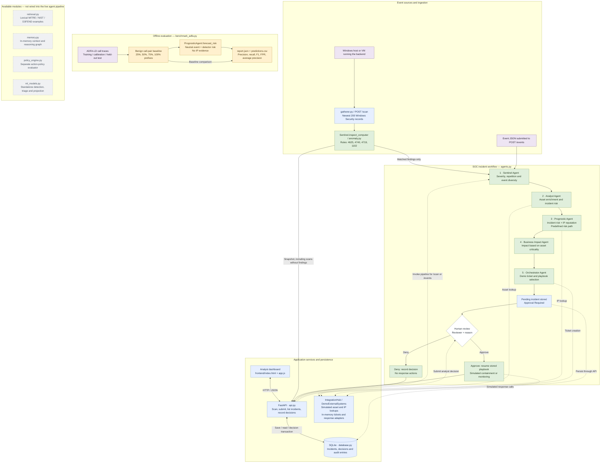

# SOC Assistant architecture

Implemented workflow with default human approval enabled. Agent logic and enrichment are deterministic demonstrations. The ADFA experiment is a separate offline entry point.

## Implementation notes

- Solid arrows carry events, incidents, decisions or results. Dashed arrows indicate invocation, enrichment or persistence relationships.
- `/scan` reads the computer running the backend. Running the backend inside a VM makes that VM the collection host; RustDesk supplies desktop access.
- Scans create incidents only for matched findings. Submitted `/events` payloads enter the pipeline directly.
- With default settings, the Orchestrator pauses for review. The decision API restores the stored pending incident and resumes its selected playbook without repeating detection. SQLite serializes decision updates.
- The Business Impact Agent also updates metrics after initial response evaluation; MTTR and alert-to-action times are currently placeholders.
- `PolicyEngine` is separate from the active approval mechanism in `OrchestratorAgent` and the decision API.
- The ADFA lane uses the same Prognostic Agent class, instantiated separately. It bypasses Sentinel, Analyst, BI, Orchestrator, the API and SQLite. With no IP evidence, its prognostic score is 0.7 times the detector score, rounded. The experiment measures partial-trace attack classification, not attack-onset forecasting.
- There is no active LLM, embedding pipeline or vector database in this workflow. Show those in a separately labeled future architecture if needed.

## Edit and export

Edit this Mermaid block to change groups, labels or arrows. GitHub renders Mermaid in Markdown. To export for a report, paste the block contents into a Mermaid editor that supports SVG/PNG export. SVG preserves sharp text at different sizes.

To resemble the reference image, retain a vertical green agent lane, blue application services, purple input sources, a white decision diamond, and an amber evaluation lane. Use an amber RAG lane only for a clearly labeled future design.

## Source map

| Component | Implementation |
| --- | --- |
| Collection and Security rules | `backend/gatherer.py`, `backend/anomaly.py`, `SentinelAgent.inspect_computer` |
| Five agents and human review | `backend/agents.py` |
| API and dashboard | `backend/api.py`, `backend/frontend/` |
| Persistent incidents and decisions | `backend/database.py` |
| Simulated integrations | `backend/integrations.py`, `DemoExternalSystems` |
| Offline evaluation | `backend/benchmark_adfa.py`, `backend/evaluation.py` |
| Additional modules | `backend/retrieval.py`, `backend/memory.py`, `backend/policy_engine.py`, `backend/ml_models.py` |
